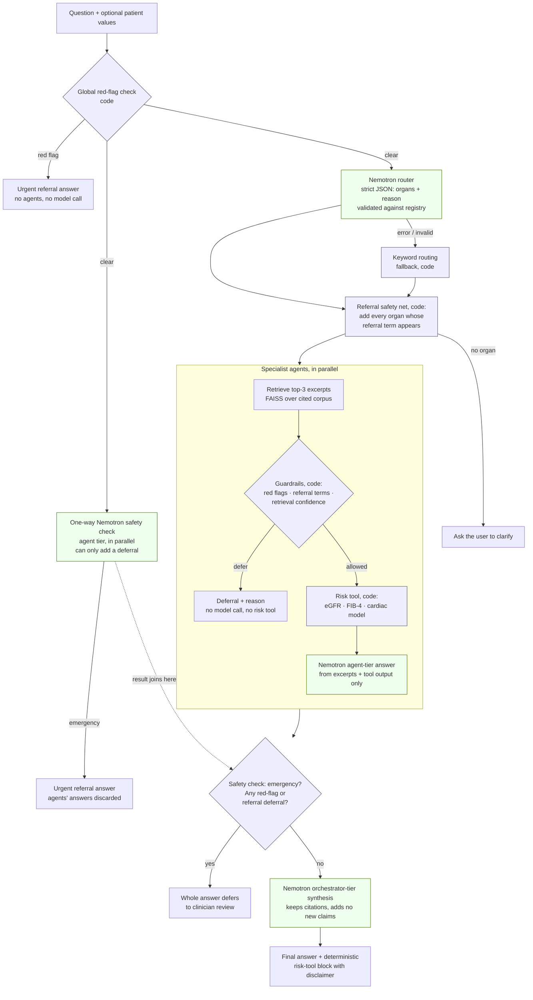

# Samanvay

*Six specialists. One careful answer.*

[](LICENSE)


**Open source under the [MIT License](LICENSE).**

Samanvay (समन्वय) means 'coordination' in Sanskrit. It brings six specialist AI agents together into one careful answer.

Multi-agent clinical decision support **designed for health workers and
doctors in Indian primary health centres**, built for the **Nebius x NVIDIA
hackathon** (track: **Best Apps and Agents**). Its clinical core is the
WHO PEN protocol, a package WHO designed specifically *for primary health
care in low-resource settings*. An orchestrator on NVIDIA Nemotron routes
each question to organ-specialist agents, each grounded in cited WHO/NIH
excerpts, and combines their answers — with deterministic guardrails that
tell the user to refer instead of guessing.

> **Decision support, not diagnosis.** This is a hackathon prototype, not a
> medical device. It does not replace clinical judgment.

- **Live demo:** https://samanvay-z93y.onrender.com (Render free tier: the first request after 15 idle minutes takes about a minute)
- **Repository:** https://github.com/NANDINI502/samanvay

## Contents

- [Who it's for](#who-its-for)
- [What it does](#what-it-does)
- [The AI can only make the system more cautious](#the-ai-can-only-make-the-system-more-cautious)
- [Routing](#routing-nemotron-first-keywords-as-fallback-referrals-always)
- [Live web fallback (Tavily)](#live-web-fallback-tavily)
- [Architecture](#architecture)
- [Which Nemotron model does what, and why](#which-nemotron-model-does-what-and-why)
- [How Nebius Token Factory is used](#how-nebius-token-factory-is-used)
- [Other Nebius tools](#other-nebius-tools)
- [Setup and run](#setup-and-run)
- [Tests](#tests)
- [Evaluation](#evaluation)
- [Risk tools, datasets and metrics](#risk-tools-datasets-and-metrics)
- [Known limitations](#known-limitations)
- [Feedback on Nebius & NVIDIA tools](#feedback-on-nebius--nvidia-tools)
- [What changed during the submission period](#what-changed-during-the-submission-period)

## Who it's for

**Designed for** health workers and doctors in Indian primary health
centres (PHCs). The design assumes a user who sees chronic conditions
(blood pressure, diabetes, kidney, liver and lung problems) without a
specialist on site, and whose key questions are *"what does this value
mean?"* and *"does this patient need referral now?"*

That is the setting the WHO PEN protocol was written for:

> World Health Organization. *Package of Essential Noncommunicable (PEN)
> Disease Interventions for Primary Health Care in Low-Resource Settings.*
> Geneva: WHO. ISBN 978 92 4 150655 7.
> [PDF (WHO AFRO)](https://www.afro.who.int/sites/default/files/2017-06/9789241506557_eng.pdf)

How the corpus uses it:

| Corpus | WHO PEN content | Other cited sources |
| --- | --- | --- |
| Cardiac | Total CVD risk factors, risk-chart actions, referral | WHO/ISH risk prediction charts (WHO pocket guidelines, 2007) |
| Renal | Kidney-related referral and blood-pressure rules | NIDDK (NIH) |
| Neuro | Stroke/TIA referral rule | NINDS (NIH) |
| Endocrine | Diagnostic thresholds, BP threshold in diabetes | WHO diabetes fact sheet |
| Hepatic | — | WHO hepatitis B fact sheet, NIDDK (NIH) |
| Respiratory | — | WHO COPD and asthma fact sheets |

Design choices that follow from this setting:

- **Referral first.** Red flags and PEN referral criteria are checked in
  code before any model call and override everything else. The system
  says *refer*; it doesn't try to manage an emergency.
- **Calculators that need only routine values.** eGFR uses serum
  creatinine, age and sex; FIB-4 uses age, AST, ALT and platelets. Missing
  values make the tool ask for them; it never guesses.
- **Cited, checkable answers.** Every answer links to the public WHO/NIH
  source it came from, so a doctor can verify it.

**Status:** this is a hackathon prototype. It has not been deployed in,
piloted at or evaluated by any health centre, and it is not a medical
device.

## What it does

Ask a clinical question in plain language, optionally with patient values.

- **Six specialist agents** — Cardiac, Renal, Neuro, Hepatic, Respiratory,
  Endocrine. A Nemotron router picks the relevant ones and says why in one
  line (keyword routing is the fallback) (often several, e.g.
  *"Diabetic patient with eGFR 50 — what blood pressure threshold
  applies?"* consults Cardiac, Renal and Endocrine) and runs them in
  parallel.
- **Grounded answers.** Each agent answers only from retrieved excerpts of
  its own curated corpus and cites the source URLs. Each corpus lists what
  it does *not* cover, and the agent is told those limits.
- **Safety in code, not in the prompt.** Emergency red flags (chest pain,
  stroke signs, vomiting blood, …), in English, Hindi and Hinglish, stop
  the request before any model call.
  Organ-specific referral criteria and low retrieval confidence make an
  agent defer; a red flag or referral from any agent defers the whole
  answer.
- **Risk tools** an agent runs when you give it patient values:
  - **eGFR** — 2021 CKD-EPI creatinine equation, race-free (Renal)
  - **FIB-4** — liver fibrosis index (Hepatic)
  - **Coronary artery disease model** — trained on the UCI Cleveland dataset (Cardiac)

  Missing or invalid values make the tool ask for them; it never guesses.
- **Transparent trace.** The web UI shows which step ran in code and which
  Nemotron model handled each model step, with latency and token counts in
  live mode.
- **Two modes, one engine.** *Clinician*: full detail, numbers, risk-tool
  output and sources, in English. *Health worker*: simple language in
  English, Hindi or Hinglish; red-flag, referral and other deferral
  messages in the chosen language; every answer ends with a fixed
  *Next step* line (what to do now, when to refer). Only the wording
  changes (`orchestrator/audience.py`): routing, guardrails, agents, risk
  tools and citations are identical, which `tests/test_audience.py` checks
  on every eval case in every mode. The pipeline trace is shown in both.

## The AI can only make the system more cautious

Safety rules run in code, so no prompt can talk them out of a deferral.
But keyword lists miss things people actually say: *"there is blood in her
vomit"* contains no listed phrase. So one Nemotron call is added, with a
strict one-way contract:

| The safety model says… | What happens |
| --- | --- |
| *emergency* | The whole answer defers as urgent, exactly like a keyword red flag. Agents' answers are discarded and synthesis never runs. |
| *not an emergency* | Nothing changes. Referral terms and retrieval confidence still run as before. |
| error, timeout, or anything but the strict JSON reply | Nothing changes: the deterministic result stands, and the trace says the check was unavailable. |

- It runs **after** the keyword check, which has already deferred any
  listed red flag; a keyword red flag never reaches the model, so the model
  has no opportunity to overrule it.
- Its definition of an emergency is **our existing red-flag list**, passed
  in the prompt. It recognises other wordings and languages for those signs
  and adds no clinical criteria of its own.
- It runs **in parallel** with routing and the specialist agents (agent
  tier, `temperature=0`, timeout `MEDBOT_SAFETY_TIMEOUT_S`, default 10 s),
  and its result is in before any answer is returned, so it adds little
  latency.
- Tested with faked model replies (`tests/test_safety.py`): emergency
  defers; "clear" can't remove a referral; timeouts, errors, non-JSON and
  non-boolean replies fall back; an emergency still wins if an agent's
  model call fails.
- The eval reports it separately: keyword **red-flag recall** must stay at
  100% with or without the model, and **paraphrase recall** and **safety
  false alarms** (live only) measure what the model adds and what it costs.

## Routing: Nemotron first, keywords as fallback, referrals always

1. **Nemotron router** (`NEMOTRON_ROUTER_MODEL`, `temperature=0`): returns
   strict JSON `{"organs": [...], "reason": "..."}`. Any name not in
   `agents/registry.py`, or any malformed reply, rejects the whole reply.
   The reason is shown in the UI's pipeline trace. Keyword matches the
   router left out are added to its pick: live, Nemotron consistently
   dropped Cardiac from *"Diabetic patient with eGFR 50 — what blood
   pressure threshold applies?"* (eval case `multi-01`), while keywords
   miss what the router catches (plurals, paraphrases; `multi-03`).
2. **Keyword fallback** on error, timeout (`MEDBOT_ROUTER_TIMEOUT_S`) or an
   invalid reply; also in mock mode, or with `MEDBOT_ROUTER=keyword`.
3. **Referral safety net**, whichever router ran: every organ whose
   referral term appears in the question is consulted, so its referral rule
   always runs. The router can add agents, never hide a referral. This
   also closed a gap in the original keyword-only design, where 7 referral
   terms (e.g. *DKA*, *varices*, *transient ischemic attack*) weren't
   routing keywords, so their referral rule never ran; the question got
   "please clarify" instead of a referral (eval cases `referral-07..09`).

`python -m eval.run --compare-routers` runs the eval with both routers and
lists every case where they disagree.

## Live web fallback (Tavily)

When an agent's own corpus has no confident match (best TF-IDF score below
`MIN_SCORE` = 0.12, `rag/embed.py`), it normally defers ("not sure enough").
With the fallback on, that one kind of deferral can instead be answered
from a live search (`rag/web.py`):

- **Only replaces a low-confidence deferral.** Red flags, referral terms
  and the safety check run first and still defer; the web never answers
  anything the guardrails stop. Risk tools don't run on web answers.
- **WHO, NIH and CDC only:** Tavily's `include_domains` (mode `restrict`)
  plus an https + host check in code. Any error, timeout or no allowed
  result keeps the deferral.
- **Labelled.** The answer ends with a fixed *Live web source* block
  listing the pages used ("not this tool's reviewed guidance").
- Off unless `MEDBOT_WEB_FALLBACK=1` and `TAVILY_API_KEY` are set; never in
  mock mode.

**Try it:** the *Live web source* case in the UI, *"Is zika virus dangerous
for the brain?"*. The Nemotron router sends it to Neuro, whose best corpus
match scores 0.09, so it reaches the fallback. Run live twice on
2026-10-26, it was answered both times from who.int and cdc.gov pages (eval
case `web-01`). The pages found vary between runs: on the deployed demo
(2026-10-27) the same question cited cdc.gov and pmc.ncbi.nlm.nih.gov.

**How often it fires.** Not often, and only by word overlap. TF-IDF scores
shared words, not meaning, so an in-domain question the corpus doesn't
cover usually still clears 0.12 when it shares words like *heart*, *liver*
or *diabetes* with the corpus; the agent then answers from its excerpts
and is told the corpus's limits. In a probe of 21 such questions
(2026-10-26, top score per intended organ), 9 scored below 0.12 and would
use the web if routed there (e.g. *"What is atrial fibrillation?"* 0.07);
12 scored 0.12–0.25 and stay with the corpus (e.g. *"Is fatty liver
reversible?"* 0.24). 0.12 was set from `python -m rag.calibrate`: on-topic
questions mostly score 0.2–0.45, off-topic text up to about 0.2. Raising it
would send more questions to the web, including some the corpus does
cover.

## Architecture



| Path | Role |
| --- | --- |
| `orchestrator/client.py` | The **only** module that calls a model: Nebius Token Factory via its OpenAI-compatible API. Records model, tier, latency and tokens per call. |
| `orchestrator/router.py` | Red-flag check, routing, parallel agents, aggregation rules, synthesis |
| `orchestrator/safety.py` | One-way Nemotron safety check: can add an emergency deferral, never remove one |
| `eval/` | Behaviour eval: `cases.jsonl` (expected agents / deferral / tool, no expected answers) and `python -m eval.run` |
| `agents/specialist.py`, `agents/registry.py` | One generic agent class, configured per organ (keywords, referral terms, scope) |
| `rag/` | Curated corpora (`corpus/`), chunking + FAISS index (`ingest.py`), retrieval, threshold calibration |
| `guardrails/checks.py` | Deterministic red flags, referral terms, retrieval confidence |
| `models/` | Risk tools: `renal/egfr.py`, `hepatic/fib4.py`, `cardiac/` (trained), `tool.py` (shared interface) |
| `api/` | FastAPI backend + single-page UI (`static/index.html`) |
| `experiments/negative_results/` | Retired renal/hepatic ML models and why they were retired |
| `scripts/check_nebius.py` | Live-mode readiness check for Token Factory |

## Which Nemotron model does what, and why

| Role | Configured by | Default model ID | Calls per question |
| --- | --- | --- | --- |
| **Orchestrator** — synthesizes the agents' answers into one response | `NEMOTRON_ORCHESTRATOR_MODEL` | `nvidia/Nemotron-3-Ultra-550b-a55b` (Ultra tier) | 1, only when at least one agent answered |
| **Router** — picks the specialist agents, returns strict JSON with a one-line reason | `NEMOTRON_ROUTER_MODEL` | the agent model (Super tier) | 1 |
| **Safety check** — one-way: can only add an emergency deferral | `NEMOTRON_SAFETY_MODEL` | the agent model (Super tier) | 1 (in parallel with routing and the agents) |
| **Specialist agents** — answer from retrieved excerpts | `NEMOTRON_AGENT_MODEL` | `nvidia/nemotron-3-super-120b-a12b` (Super tier) | 1 per consulted agent (run in parallel) |

All three IDs (Ultra, Super, and Nano `nvidia/NVIDIA-Nemotron-3-Nano-30B-A3B`)
were confirmed against the Token Factory model list on 2026-10-20 with
`python scripts/check_nebius.py`.

**Why this split.**

- **Orchestrator → largest tier (Ultra).** Synthesis is the hardest step:
  combine several agents' answers, point out interactions only when both
  answers support them (e.g. diabetes changing a blood-pressure threshold),
  add no new claims, and keep every citation and disclaimer. It runs once
  per question, so the larger model's cost is paid once.
- **Agents → Super tier.** Each agent's task is narrow: answer from three
  retrieved excerpts of one corpus, or say the excerpts don't cover it. All
  agents share one setting, `NEMOTRON_AGENT_MODEL`. The expectation was
  that a smaller tier would also be faster; the benchmark below found the
  opposite on Token Factory in this run (Ultra fastest, Nano slowest).
- **No model sees ungrounded questions.** Red flags, referral terms and
  weak retrieval are handled in code before any model call, so the safety
  behaviour doesn't depend on which model is configured.

### Tier benchmark: Nano vs Super vs Ultra per role

`MEDBOT_MOCK_LLM=0 python -m scripts.benchmark_tiers` changes one role's
model at a time (the others keep the defaults above) and runs that role on
the eval cases that exercise it. Live run 2026-10-25,
`eval/results/benchmark_20261025T161928Z.json`. Latency and tokens are per
call of the role being varied; end-to-end is the whole question.

> The behaviour checks below use the same self-written eval cases (see
> [Evaluation](#evaluation)): 100% means the system behaves as designed
> on these cases, not clinical accuracy.

**Router** (37 non-emergency cases; accuracy includes the keyword and
referral safety nets, as in production)

| Tier | Routing accuracy | Keyword net had to add an organ | Fallbacks | p50 | p95 | Tokens/call |
| --- | --- | --- | --- | --- | --- | --- |
| Nano | 100% (37/37) | 4 | 0 | 1.3 s | 1.6 s | 250 |
| Super (default) | 100% (37/37) | 2 | 0 | 1.6 s | 2.3 s | 264 |
| Ultra | 100% (37/37) | 1 | 0 | 1.5 s | 1.5 s | 259 |

**Safety check** (10 paraphrased emergencies + 37 non-emergency cases)

| Tier | Paraphrase recall | False alarms | Unavailable | p50 | p95 | Tokens/call |
| --- | --- | --- | --- | --- | --- | --- |
| Nano | 100% (10/10) | 5% (2/37) | 0 | 1.3 s | 1.5 s | 235 |
| Super (default) | 100% (10/10) | 0% (0/37) | 0 | 1.6 s | 1.9 s | 250 |
| Ultra | 100% (10/10) | 0% (0/37) | 0 | 1.5 s | 1.6 s | 243 |

**Specialist agents** (24 single/multi-organ and risk-tool cases; orchestrator Ultra)

| Tier | Eval checks | Grounding | Errors | Call p50 | Call p95 | Tokens/call | End-to-end p50 |
| --- | --- | --- | --- | --- | --- | --- | --- |
| Nano | 100% (24/24) | 100% (22/22) | 0 | 5.4 s | 10.1 s | 981 | 9.7 s |
| Super (default) | 100% (24/24) | 100% (22/22) | 0 | 3.2 s | 6.1 s | 952 | 7.2 s |
| Ultra | 100% (24/24) | 100% (22/22) | 0 | 2.6 s | 3.0 s | 1011 | 7.3 s |

**Orchestrator / synthesis** (same 24 cases; agents Super)

| Tier | Eval checks | Grounding | Errors | Call p50 | Call p95 | Tokens/call | End-to-end p50 |
| --- | --- | --- | --- | --- | --- | --- | --- |
| Nano | 100% (24/24) | 100% (22/22) | 0 | 4.1 s | 10.9 s | 1631 | 8.7 s |
| Super | 100% (24/24) | 100% (22/22) | 0 | 3.9 s | 6.4 s | 981 | 9.9 s |
| Ultra (default) | 100% (24/24) | 100% (22/22) | 0 | 3.1 s | 4.5 s | 1138 | 7.7 s |

**What this says, and what it doesn't.**

- Every tier passed every behaviour check in every role, so on these cases
  the tier choice is about latency, tokens and a few edge behaviours, not
  correctness.
- **Router:** Nano routes as well once the keyword safety net runs, but it
  left out an organ the keywords had to add back 4 times (Super 2, Ultra 1).
  Kept on Super; the net is a backstop, not something to lean on.
- **Safety check:** Nano raised 2 false emergencies, both on referral
  questions ("suspected ketoacidosis", "possible transient ischemic attack
  yesterday"). These defer anyway, so the result is the urgent message in
  place of the referral one: safe, but the wrong message. Kept on Super.
- **Agents:** Ultra was the fastest tier and Nano the slowest, with similar
  tokens per call, so model size didn't predict latency here (the run
  doesn't show why). Kept on Super for now: one run, and the two Super-agent /
  Ultra-orchestrator runs (the same configuration, measured twice) differ
  by 0.5 s end to end, which is the noise level here.
- **Orchestrator:** Ultra was fastest and steadiest (p95 4.5 s); Nano used
  the most tokens (1,631 per call). Kept on Ultra.
- Limits: 24–47 cases per role, one run each, one day's Token Factory
  load. Tokens are reported, not price: per-token prices differ by tier and
  weren't part of the run. The checks score behaviour (routing, deferral,
  tool choice, citations), not the medical quality of the wording.

## How Nebius Token Factory is used

- **All inference runs on Token Factory**, through its OpenAI-compatible
  endpoint (`NEBIUS_BASE_URL`, default `https://api.tokenfactory.nebius.com/v1/`)
  with the official `openai` Python client. `orchestrator/client.py` is the
  single place that talks to it; nothing else in the code base imports a
  model client.
- Per call it records the model that served it, the role (orchestrator or
  agent), wall-clock latency and the token usage returned by the API; the
  UI's pipeline trace and `/api/ask` show these.
- `scripts/check_nebius.py` lists the models available to your key,
  highlights the Nemotron ones, flags configured IDs that aren't available,
  and makes one tiny test call with latency and token counts. It never
  prints the key (output passes through `redact()`; tested).
- Optional: `EMBED_BACKEND=nebius` + `NEBIUS_EMBED_MODEL` switches retrieval
  embeddings to a Token Factory embedding model (written, not yet tested
  live; default is offline TF-IDF).
- `MEDBOT_MOCK_LLM=1` replaces every model call with a clearly labelled stub
  so the whole pipeline runs offline for tests and demos.

## Other Nebius tools

Token Factory is the only Nebius service the submitted demo uses. The demo
runs as a Docker web service on Render's free tier. A Nebius deployment is
documented in [DEPLOY.md](DEPLOY.md) but was not used:

- [ ] **Nebius Serverless AI Endpoints** — runs the app container (CPU preset)
- [ ] **Nebius Container Registry** — hosts the image
- [ ] **Nebius SecretStash** — injects `NEBIUS_API_KEY` via `--env-secret`

## Setup and run

Requires Python 3.12.

```bash
git clone https://github.com/NANDINI502/samanvay && cd samanvay
python -m venv .venv
source .venv/bin/activate          # Windows: .venv\Scripts\activate
pip install -r requirements.txt -c constraints.txt
cp .env.example .env               # Windows cmd: copy .env.example .env; live mode: add NEBIUS_API_KEY
python -m rag.ingest --organ all   # optional; the web app builds missing indexes at startup
```

**Mock mode** (offline, no key; replies are labelled stubs, guardrails and
risk tools are real):

```bash
MEDBOT_MOCK_LLM=1 uvicorn api.app:app --port 8000        # http://127.0.0.1:8000
MEDBOT_MOCK_LLM=1 python -m orchestrator.cli "What GFR value suggests kidney disease?"
```

**Live mode** (Nemotron on Token Factory):

```bash
python scripts/check_nebius.py     # key works? models available? one test call
MEDBOT_MOCK_LLM=0 uvicorn api.app:app --port 8000
python -m orchestrator.cli "Diabetic patient with eGFR 50 — what blood pressure threshold applies?"
python -m orchestrator.cli "What does this patient's eGFR mean?" \
  --values '{"age": 60, "sex": "male", "serum_creatinine": 1.8}'
python -m orchestrator.cli --inputs hepatic   # inputs a risk tool needs
```

**Docker / deployment:** see [DEPLOY.md](DEPLOY.md). The live demo runs as a
Docker web service on Render's free tier (section R); Hugging Face Spaces and
Nebius Serverless Endpoints are also documented. The API key is supplied only
as a platform secret, never in the image. Health check: `GET /api/health`
(GET or HEAD, never rate-limited, no model call).

## Tests

```bash
pytest tests/
```

All tests run offline (`tests/conftest.py` sets `MEDBOT_MOCK_LLM=1`).

| File | Covers |
| --- | --- |
| `test_guardrails.py` | Red flags (English, Hindi, Hinglish, spelling variants), word-boundary keyword matching, referral terms, retrieval confidence |
| `test_router.py` | Nemotron router: strict JSON validated against the registry, keyword fallback on failure, referral safety net |
| `test_safety.py` | One-way safety check: adds deferrals only, falls back on error/timeout/bad JSON |
| `test_eval.py` | Eval case file is well-formed; harness scores a known case |
| `test_retrieval.py` | Each corpus retrieves the right section for representative questions |
| `test_orchestrator.py` | Routing, parallel agents, aggregation and deferral rules |
| `test_calculators.py` | eGFR and FIB-4 against hand-computed values from the published formulas, band edges, invalid/missing inputs, guardrails blocking the tools |
| `test_risk_models.py` | Cardiac model: retraining reproduces the saved model and metrics; real dataset rows only |
| `test_negative_results.py` | Retired models' metrics reproduce exactly; they are not served |
| `test_api.py` | Web API, per-step model trace, health check, 503 on model failure without leaking the key |
| `test_check_nebius.py` | Readiness script with faked Token Factory responses; key never printed |
| `test_audience.py` | Clinician vs health-worker mode: only the wording changes; routing, guardrails, tools and citations are identical |
| `test_ratelimit.py` | `/api/ask` per-IP limit (default 30/hour; a forged `X-Forwarded-For` doesn't reset it) and daily cap; `/api/health` (GET and HEAD) never limited and makes no model call |
| `test_web_fallback.py` | Tavily fallback with a stubbed HTTP call: replaces only a low-confidence deferral; allowed domains only |
| `test_benchmark_tiers.py` | Tier benchmark plumbing: case selection, percentiles, one role varied at a time |

One strict `xfail` documents a known retrieval limitation (below).

## Evaluation

`MEDBOT_MOCK_LLM=0 python -m eval.run` runs every case in `eval/cases.jsonl`
through the full live pipeline and scores what the system *did*, never what
it said medically. Final live run 2026-10-26 (Nemotron router, Ultra
orchestrator, Super agents, web fallback on), `eval/results/20261026T095448Z.json`:

> **What these numbers mean.** The 66 eval cases are test cases we wrote
> ourselves to check routing and safety behaviour (which agents run, when
> the system defers, which risk tool runs, whether sources are cited). They
> are **not clinical validation**. 100% means the system behaves as designed
> on these cases, not that its answers are clinically accurate.

| Metric | Result |
| --- | --- |
| Routing accuracy (exact set of agents) | 100% (37/37) |
| Red-flag recall (en 8/8, hi 5/5, Hinglish 6/6) | 100% (19/19) |
| Paraphrased emergencies caught by the safety check | 100% (10/10) |
| Safety-check false alarms | 0% (0/37) |
| Deferral precision (red flag vs referral) | 100% (39/39) |
| Referral recall | 100% (10/10) |
| Risk-tool selection | 100% (66/66) |
| Risk-tool status (ok / needs values / invalid) | 100% (8/8) |
| Grounding (answer cites a retrieved source URL) | 100% (24/24) |
| Web fallback answered, labelled, allowed domains only | 100% (2/2) |
| Web domain violations | 0 |
| Errors | 0 |

Grounding checks only that a retrieved source is cited, not that every
sentence is supported by it.

## Risk tools, datasets and metrics

Full dataset provenance: [DATASETS.md](DATASETS.md). Retired models:
[experiments/negative_results/README.md](experiments/negative_results/README.md).

### eGFR — Renal agent (published equation)

- **Equation:** 2021 CKD-EPI creatinine, without race. Coefficients from
  Inker LA, et al. *N Engl J Med* 2021;385:1737-1749, Table 2
  ([doi:10.1056/NEJMoa2102953](https://doi.org/10.1056/NEJMoa2102953)):
  `eGFR = 142 × min(Scr/κ,1)^α × max(Scr/κ,1)^−1.200 × 0.9938^Age × 1.012 [if female]`,
  κ = 0.7 (F) / 0.9 (M), α = −0.241 (F) / −0.302 (M), Scr in mg/dL.
- **Interpretation:** only the NIDDK thresholds already in the renal corpus
  (≥ 60 normal range; < 60 may mean kidney disease; ≤ 15 kidney failure).
  No CKD staging. Adults only (≥ 18), with the paper's caveat that it may not
  apply in acute care.
- **Input sanity checks** (refused, never converted; not clinical
  thresholds): age above 120; serum creatinine above 20 mg/dL gets *"This
  looks like µmol/L. Enter mg/dL (µmol/L ÷ 88.4)."* The factor 88.4 is from
  the paper's Table 1 footnote, where creatinine averaged 1.16–1.66 mg/dL
  (SD 0.70–1.16), so 20 mg/dL is over 15 SD above every mean. Any true value
  above 20 would be in the ≤ 15 band anyway. Reasoning in
  `models/renal/egfr.py`.

### FIB-4 — Hepatic agent (published formula)

- **Formula:** Sterling RK, et al. *Hepatology* 2006;43(6):1317-1325
  ([doi:10.1002/hep.21178](https://doi.org/10.1002/hep.21178)):
  `(Age × AST) / (Platelets [10^9/L] × √ALT)`.
- **Cutoffs, as reported in the source's validation set:** < 1.45 → NPV 90%,
  sensitivity 70% for excluding advanced fibrosis (Ishak 4–6); > 3.25 → PPV
  65%, specificity 97%. Derived in 832 patients with HIV/HCV coinfection;
  every result states that population caveat.

### Cardiac — trained model (UCI Heart Disease, Cleveland)

*Model estimate from a small 1988 research dataset (Cleveland Clinic,
collected 1981-84), not a diagnosis.* 303 patients referred for coronary
angiography; target = > 50% narrowing in any major vessel (139 positive,
46%). Logistic regression chosen over a shallow gradient-boosted tree by
5×5 repeated stratified cross-validation:

| Metric (cross-validated) | Logistic regression (shipped) | Gradient boosting |
| --- | --- | --- |
| AUC (mean ± SD, 5×5 CV) | 0.911 ± 0.036 | 0.898 ± 0.039 |
| Sensitivity / specificity at 50% (out-of-fold) | 0.81 / 0.88 | 0.77 / 0.85 |
| Calibration slope (ideal 1.0) / Brier score | 0.88 / 0.118 | 0.95 / 0.131 |

A referral population, not a general one: e.g. *asymptomatic* chest pain is
the strongest positive predictor here. The tool refuses values outside the
training range instead of extrapolating.

### Negative results (retired, kept for transparency)

| Retired model | Result | Why it was retired | Replaced by |
| --- | --- | --- | --- |
| UCI Chronic Kidney Disease (400 patients) | CV AUC **1.00**, calibration slope 16.4 | Suspected label leakage: the label most likely derives from the inputs (creatinine, urea, haemoglobin, albumin); the score says nothing about new patients | eGFR equation |
| UCI ILPD (583 patients, 71% positive) | AUC 0.745; **specificity 0.22** at a 50% threshold | Almost always predicts "liver patient" (37 of 167 non-patients identified); PPV 0.75 barely above the 0.71 base rate; lab units undocumented | FIB-4 formula |

Re-running `python -m experiments.negative_results.<name>.train`
reproduces these numbers exactly (tested).

## Known limitations

- **Not done: native tool calling** (plan step H: Nemotron calling the
  risk tools through OpenAI-style `tools`). We chose to skip it so the
  tool path stayed as tested in the final days. Tools are picked in code
  instead: an agent runs its risk tool only when the guardrails allow it
  and the user gave that tool's values. Whether Nemotron on Token Factory
  supports `tools` was not tested.
- **Tests run offline; live behaviour is checked by the eval.** `pytest`
  uses mock replies. Live runs are the eval and tier benchmark above:
  66 self-written cases, one run at a time.
- **Lexical retrieval (TF-IDF) by default.** It can't tell an in-domain but
  uncovered question ("liver transplant waiting list rules") from a covered
  one; such questions reach the model, which is told the corpus's limits.
  Tracked by a strict `xfail` in `tests/test_orchestrator.py`. The Nebius
  embedding backend is written but untested.
- Questions with little word overlap (e.g. "when to start a statin") can
  fall under the confidence threshold and defer — safe, but a miss.
- The Nemotron router's fallback, keyword routing, is simple: ambiguous
  words can pull in an extra agent, and plurals are missed ("kidneys"
  doesn't match "kidney"; eval case `multi-03`).
- Corpora are short curated excerpts, not full guidelines, and some sources
  are dated (NIDDK CKD page last reviewed 2016) — noted in each file.
- The cardiac model comes from a small 1980s referral population and is
  not validated elsewhere. The calculators are only as good as their
  sources' populations (FIB-4: HIV/HCV coinfection; eGFR: ambulatory adults).
- When a referral term defers the whole answer, the final message doesn't
  separately say that a requested risk tool was skipped (the agent card does).
- All agents share one model setting; per-agent model choice isn't
  configurable yet.
- The one-way safety check's paraphrase recall (10/10) and false alarms
  (0/37) are measured on only 10 + 37 self-written cases. Any false alarm
  makes an answer defer (safe, but a cost).
- The web fallback's allowed domains include all of nih.gov, so it can
  cite research papers rather than guidance: live, eval case `web-02` cited
  pmc.ncbi.nlm.nih.gov articles. How often it fires depends on TF-IDF word
  overlap (see [Live web fallback](#live-web-fallback-tavily)).
- Hindi/Hinglish red-flag phrases were translated for this project and
  need native-speaker clinical review (see `guardrails/README.md`). The
  same goes for the health-worker mode's fixed Hindi/Hinglish messages
  (`orchestrator/audience.py`).
- Health-worker mode: the risk-tool block and its disclaimer stay in
  English. The model-written part of an answer in Hindi/Hinglish isn't
  scored: the eval runs in clinician mode and checks behaviour, not wording.
- Grounding is enforced by prompt, not code: live, an agent sometimes
  drew a conclusion its excerpts don't state (from "test people with high
  blood pressure for kidney disease" to "high blood pressure can damage the
  kidneys"). The prompts now forbid this and it became rarer, but the eval
  checks only that sources are cited, not that every sentence is supported.
- Not a medical device; no clinical validation of the system as a whole.

## Feedback on Nebius & NVIDIA tools

_To be written from the team's own experience — nothing here is filled in
on our behalf._

**Nebius Token Factory**
- What worked well: `<FEEDBACK>`
- What was hard or confusing: `<FEEDBACK>`
- Suggestions: `<FEEDBACK>`

**NVIDIA Nemotron models**
- Answer quality / grounding behaviour: `<FEEDBACK>`
- Latency and token usage (see the UI's pipeline trace): `<FEEDBACK>`
- Suggestions: `<FEEDBACK>`

**Other Nebius tools (Serverless Endpoints, Container Registry, SecretStash)**
- `<FEEDBACK>`

## What changed during the submission period

From `git log` (dates are commit dates, UTC+8):

- **2026-10-17** — First build: six RAG specialist agents, deterministic guardrails, eGFR / FIB-4 / cardiac risk tools (UCI kidney and liver models retired), Token Factory check script, FastAPI web UI, Dockerfile.
- **2026-10-19** — WHO PEN positioning for Indian PHCs; behaviour eval harness (`eval/`); Hindi/Hinglish red flags; one-way safety check; Nemotron router with keyword fallback.
- **2026-10-19** — Health-worker mode (simple language, Hindi/Hinglish, fixed *Next step*); "dil ka daura" red flag relabelled as chest pain.
- **2026-10-20** — First live run on Token Factory: Ultra model ID fixed, reasoning off for router/safety JSON calls, keyword matches added to Nemotron routing; live eval all 100%.
- **2026-10-22** — UI redesign: three-column dashboard, history, voice input.
- **2026-10-24** — Guard for answers cut off at `max_tokens`; stricter grounding prompts; two live re-checks, all 100%.
- **2026-10-24** — DEPLOY.md: Hugging Face, Nebius Serverless and Render routes.
- **2026-10-25** — Public-demo hardening for Render: `/api/ask` rate limits, `MEDBOT_MAX_TOKENS_CAP`.
- **2026-10-25** — Tavily live web fallback for low-confidence deferrals (WHO/NIH/CDC only); 3 eval cases; live eval 66 cases all 100%.
- **2026-10-25** — Renamed to Samanvay.
- **2026-10-26** — Model-tier benchmark (Nano / Super / Ultra per role); safety check gets its own model setting.
- **2026-10-26** — Final live eval; README: eval results, web fallback, limitations; *Live web source* example in the UI.
- **2026-10-27** — "Care" UI redesign (NHS-style triage cards, score rings, read-aloud); design rationale in `docs/DESIGN.md`.
- **2026-10-27** — QA sweep (`docs/QA_REPORT.md`): accessibility and error-state fixes, HEAD on `/api/health` for uptime monitors, blank questions rejected.

## License

[MIT](LICENSE). Corpus excerpts are quoted from the public WHO and NIH
sources cited in each `rag/corpus/` file; the UCI datasets are CC BY 4.0
(see [DATASETS.md](DATASETS.md)).
