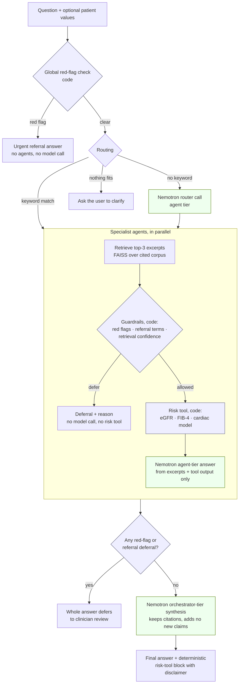

# MedBot Orchestrator

[](LICENSE)


**Open source under the [MIT License](LICENSE).**

Multi-agent clinical decision support built for the **Nebius x NVIDIA
hackathon** (track: **Best Apps and Agents**). An orchestrator on NVIDIA
Nemotron routes each clinical question to organ-specialist agents, each
grounded in cited WHO/NIH excerpts, and combines their answers — with
deterministic guardrails that defer to a clinician instead of guessing.

> **Decision support, not diagnosis.** This is a hackathon prototype, not a
> medical device. It does not replace clinical judgment.

- **Live demo:** `<DEMO_URL>`
- **Repository:** `<GITHUB_REPO_URL>`

## Contents

- [What it does](#what-it-does)
- [Architecture](#architecture)
- [Which Nemotron model does what, and why](#which-nemotron-model-does-what-and-why)
- [How Nebius Token Factory is used](#how-nebius-token-factory-is-used)
- [Other Nebius tools](#other-nebius-tools)
- [Setup and run](#setup-and-run)
- [Tests](#tests)
- [Risk tools, datasets and metrics](#risk-tools-datasets-and-metrics)
- [Known limitations](#known-limitations)
- [Feedback on Nebius & NVIDIA tools](#feedback-on-nebius--nvidia-tools)
- [What changed during the submission period](#what-changed-during-the-submission-period)

## What it does

Ask a clinical question in plain language, optionally with patient values.

- **Six specialist agents** — Cardiac, Renal, Neuro, Hepatic, Respiratory,
  Endocrine. The orchestrator picks the relevant ones (often several, e.g.
  *"Diabetic patient with eGFR 50 — what blood pressure threshold
  applies?"* consults Cardiac, Renal and Endocrine) and runs them in
  parallel.
- **Grounded answers.** Each agent answers only from retrieved excerpts of
  its own curated corpus and cites the source URLs. Each corpus lists what
  it does *not* cover, and the agent is told those limits.
- **Safety in code, not in the prompt.** Emergency red flags (chest pain,
  stroke signs, vomiting blood, …) stop the request before any model call.
  Organ-specific referral criteria and low retrieval confidence make an
  agent defer; a red flag or referral from any agent defers the whole
  answer.
- **Risk tools** an agent runs when you give it patient values:
  - **eGFR** — 2021 CKD-EPI creatinine equation, race-free (Renal)
  - **FIB-4** — liver fibrosis index (Hepatic)
  - **Coronary artery disease model** — trained on the UCI Cleveland dataset (Cardiac)

  Missing or invalid values make the tool ask for them; it never guesses.
- **Transparent trace.** The web UI shows which step ran in code and which
  Nemotron model handled each model step, with latency and token counts in
  live mode.

## Architecture



| Path | Role |
| --- | --- |
| `orchestrator/client.py` | The **only** module that calls a model: Nebius Token Factory via its OpenAI-compatible API. Records model, tier, latency and tokens per call. |
| `orchestrator/router.py` | Red-flag check, routing, parallel agents, aggregation rules, synthesis |
| `agents/specialist.py`, `agents/registry.py` | One generic agent class, configured per organ (keywords, referral terms, scope) |
| `rag/` | Curated corpora (`corpus/`), chunking + FAISS index (`ingest.py`), retrieval, threshold calibration |
| `guardrails/checks.py` | Deterministic red flags, referral terms, retrieval confidence |
| `models/` | Risk tools: `renal/egfr.py`, `hepatic/fib4.py`, `cardiac/` (trained), `tool.py` (shared interface) |
| `api/` | FastAPI backend + single-page UI (`static/index.html`) |
| `experiments/negative_results/` | Retired renal/hepatic ML models and why they were retired |
| `scripts/check_nebius.py` | Live-mode readiness check for Token Factory |

## Which Nemotron model does what, and why

| Role | Configured by | Default model ID | Calls per question |
| --- | --- | --- | --- |
| **Orchestrator** — synthesizes the agents' answers into one response | `NEMOTRON_ORCHESTRATOR_MODEL` | `nvidia/nemotron-3-ultra-253b-a15b` (Ultra tier) | 1, only when at least one agent answered |
| **Specialist agents** — answer from retrieved excerpts; also the fallback router | `NEMOTRON_AGENT_MODEL` | `nvidia/nemotron-3-super-120b-a12b` (Super tier) | 1 per consulted agent (run in parallel) + 1 if keyword routing fails |

> **Model IDs to confirm.** The defaults above are what the code is
> configured with today; the Ultra ID has not yet been confirmed against
> the Token Factory model list. Run `python scripts/check_nebius.py` and
> set the confirmed IDs in `.env` / the deployment's variables.
> `<CONFIRMED_MODEL_IDS>`

**Why this split.**

- **Orchestrator → largest tier (Ultra).** Synthesis is the hardest step:
  combine several agents' answers, point out interactions only when both
  answers support them (e.g. diabetes changing a blood-pressure threshold),
  add no new claims, and keep every citation and disclaimer. It runs once
  per question, so the larger model's cost is paid once.
- **Agents → smaller tier (Super; Nano is an option).** Each agent's task
  is narrow: answer from three retrieved excerpts of one corpus, or say the
  excerpts don't cover it. A question can fan out to several agents, so a
  smaller model keeps latency and cost down where the work is simplest.
  All agents currently share one setting, `NEMOTRON_AGENT_MODEL`; pointing
  it at a Nano-tier model needs no code change.
- **No model sees ungrounded questions.** Red flags, referral terms and
  weak retrieval are handled in code before any model call, so the safety
  behaviour doesn't depend on which model is configured.

## How Nebius Token Factory is used

- **All inference runs on Token Factory**, through its OpenAI-compatible
  endpoint (`NEBIUS_BASE_URL`, default `https://api.tokenfactory.nebius.com/v1/`)
  with the official `openai` Python client. `orchestrator/client.py` is the
  single place that talks to it; nothing else in the code base imports a
  model client.
- Per call it records the model that served it, the role (orchestrator or
  agent), wall-clock latency and the token usage returned by the API; the
  UI's pipeline trace and `/api/ask` show these.
- `scripts/check_nebius.py` lists the models available to your key,
  highlights the Nemotron ones, flags configured IDs that aren't available,
  and makes one tiny test call with latency and token counts. It never
  prints the key (output passes through `redact()`; tested).
- Optional: `EMBED_BACKEND=nebius` + `NEBIUS_EMBED_MODEL` switches retrieval
  embeddings to a Token Factory embedding model (written, not yet tested
  live; default is offline TF-IDF).
- `MEDBOT_MOCK_LLM=1` replaces every model call with a clearly labelled stub
  so the whole pipeline runs offline for tests and demos.

## Other Nebius tools

Documented and ready in [DEPLOY.md](DEPLOY.md); tick what was actually used
for the submitted demo:

- [ ] **Nebius Serverless AI Endpoints** — runs the app container (CPU preset)
- [ ] **Nebius Container Registry** — hosts the image
- [ ] **Nebius SecretStash** — injects `NEBIUS_API_KEY` via `--env-secret`

`<OTHER_NEBIUS_TOOLS_USED>`

## Setup and run

Requires Python 3.12.

```bash
git clone <GITHUB_REPO_URL> && cd medbot-orchestrator-v2
python -m venv .venv
source .venv/bin/activate          # Windows: .venv\Scripts\activate
pip install -r requirements.txt -c constraints.txt
cp .env.example .env               # live mode: add NEBIUS_API_KEY, confirm model IDs
python -m rag.ingest --organ all   # optional; the web app builds missing indexes at startup
```

**Mock mode** (offline, no key; replies are labelled stubs, guardrails and
risk tools are real):

```bash
MEDBOT_MOCK_LLM=1 uvicorn api.app:app --port 8000        # http://127.0.0.1:8000
MEDBOT_MOCK_LLM=1 python -m orchestrator.cli "What GFR value suggests kidney disease?"
```

**Live mode** (Nemotron on Token Factory):

```bash
python scripts/check_nebius.py     # key works? models available? one test call
MEDBOT_MOCK_LLM=0 uvicorn api.app:app --port 8000
python -m orchestrator.cli "Diabetic patient with eGFR 50 — what blood pressure threshold applies?"
python -m orchestrator.cli "What does this patient's eGFR mean?" \
  --values '{"age": 60, "sex": "male", "serum_creatinine": 1.8}'
python -m orchestrator.cli --inputs hepatic   # inputs a risk tool needs
```

**Docker / deployment:** see [DEPLOY.md](DEPLOY.md) — Hugging Face Spaces
(Docker) and Nebius Serverless Endpoints. The API key is supplied only as a
platform secret, never in the image. Health check: `GET /api/health`.

## Tests

```bash
pytest tests/
```

All tests run offline (`tests/conftest.py` sets `MEDBOT_MOCK_LLM=1`).

| File | Covers |
| --- | --- |
| `test_guardrails.py` | Red flags, word-boundary keyword matching, referral terms, retrieval confidence |
| `test_retrieval.py` | Each corpus retrieves the right section for representative questions |
| `test_orchestrator.py` | Routing, parallel agents, aggregation and deferral rules |
| `test_calculators.py` | eGFR and FIB-4 against hand-computed values from the published formulas, band edges, invalid/missing inputs, guardrails blocking the tools |
| `test_risk_models.py` | Cardiac model: retraining reproduces the saved model and metrics; real dataset rows only |
| `test_negative_results.py` | Retired models' metrics reproduce exactly; they are not served |
| `test_api.py` | Web API, per-step model trace, health check, 503 on model failure without leaking the key |
| `test_check_nebius.py` | Readiness script with faked Token Factory responses; key never printed |

One strict `xfail` documents a known retrieval limitation (below).

## Risk tools, datasets and metrics

Full dataset provenance: [DATASETS.md](DATASETS.md). Retired models:
[experiments/negative_results/README.md](experiments/negative_results/README.md).

### eGFR — Renal agent (published equation)

- **Equation:** 2021 CKD-EPI creatinine, without race. Coefficients from
  Inker LA, et al. *N Engl J Med* 2021;385:1737-1749, Table 2
  ([doi:10.1056/NEJMoa2102953](https://doi.org/10.1056/NEJMoa2102953)):
  `eGFR = 142 × min(Scr/κ,1)^α × max(Scr/κ,1)^−1.200 × 0.9938^Age × 1.012 [if female]`,
  κ = 0.7 (F) / 0.9 (M), α = −0.241 (F) / −0.302 (M), Scr in mg/dL.
- **Interpretation:** only the NIDDK thresholds already in the renal corpus
  (≥ 60 normal range; < 60 may mean kidney disease; ≤ 15 kidney failure).
  No CKD staging. Adults only (≥ 18), with the paper's caveat that it may not
  apply in acute care.

### FIB-4 — Hepatic agent (published formula)

- **Formula:** Sterling RK, et al. *Hepatology* 2006;43(6):1317-1325
  ([doi:10.1002/hep.21178](https://doi.org/10.1002/hep.21178)):
  `(Age × AST) / (Platelets [10^9/L] × √ALT)`.
- **Cutoffs, as reported in the source's validation set:** < 1.45 → NPV 90%,
  sensitivity 70% for excluding advanced fibrosis (Ishak 4–6); > 3.25 → PPV
  65%, specificity 97%. Derived in 832 patients with HIV/HCV coinfection;
  every result states that population caveat.

### Cardiac — trained model (UCI Heart Disease, Cleveland)

*Model estimate from a small 1988 research dataset (Cleveland Clinic,
collected 1981-84), not a diagnosis.* 303 patients referred for coronary
angiography; target = > 50% narrowing in any major vessel (139 positive,
46%). Logistic regression chosen over a shallow gradient-boosted tree by
5×5 repeated stratified cross-validation:

| Metric (cross-validated) | Logistic regression (shipped) | Gradient boosting |
| --- | --- | --- |
| AUC (mean ± SD, 5×5 CV) | 0.911 ± 0.036 | 0.898 ± 0.039 |
| Sensitivity / specificity at 50% (out-of-fold) | 0.81 / 0.88 | 0.77 / 0.85 |
| Calibration slope (ideal 1.0) / Brier score | 0.88 / 0.118 | 0.95 / 0.131 |

A referral population, not a general one: e.g. *asymptomatic* chest pain is
the strongest positive predictor here. The tool refuses values outside the
training range instead of extrapolating.

### Negative results (retired, kept for transparency)

| Retired model | Result | Why it was retired | Replaced by |
| --- | --- | --- | --- |
| UCI Chronic Kidney Disease (400 patients) | CV AUC **1.00**, calibration slope 16.4 | Suspected label leakage: the label most likely derives from the inputs (creatinine, urea, haemoglobin, albumin); the score says nothing about new patients | eGFR equation |
| UCI ILPD (583 patients, 71% positive) | AUC 0.745; **specificity 0.22** at a 50% threshold | Almost always predicts "liver patient" (37 of 167 non-patients identified); PPV 0.75 barely above the 0.71 base rate; lab units undocumented | FIB-4 formula |

Re-running `python -m experiments.negative_results.<name>.train`
reproduces these numbers exactly (tested).

## Known limitations

- **Live Nemotron calls not yet verified end to end.** The pipeline was
  built and tested in mock mode; model IDs must be confirmed with
  `scripts/check_nebius.py`. `<LIVE_TEST_STATUS>`
- **Lexical retrieval (TF-IDF) by default.** It can't tell an in-domain but
  uncovered question ("liver transplant waiting list rules") from a covered
  one; such questions reach the model, which is told the corpus's limits.
  Tracked by a strict `xfail` in `tests/test_orchestrator.py`. The Nebius
  embedding backend is written but untested.
- Questions with little word overlap (e.g. "when to start a statin") can
  fall under the confidence threshold and defer — safe, but a miss.
- Keyword routing is simple; ambiguous words can pull in an extra agent
  (which then defers quietly if it has no grounding).
- Corpora are short curated excerpts, not full guidelines, and some sources
  are dated (NIDDK CKD page last reviewed 2016) — noted in each file.
- The cardiac model comes from a small 1980s referral population and is
  not validated elsewhere. The calculators are only as good as their
  sources' populations (FIB-4: HIV/HCV coinfection; eGFR: ambulatory adults).
- When a referral term defers the whole answer, the final message doesn't
  separately say that a requested risk tool was skipped (the agent card does).
- All agents share one model setting; per-agent model choice isn't
  configurable yet.
- Not a medical device; no clinical validation of the system as a whole.

## Feedback on Nebius & NVIDIA tools

_To be written from the team's own experience — nothing here is filled in
on our behalf._

**Nebius Token Factory**
- What worked well: `<FEEDBACK>`
- What was hard or confusing: `<FEEDBACK>`
- Suggestions: `<FEEDBACK>`

**NVIDIA Nemotron models**
- Answer quality / grounding behaviour: `<FEEDBACK>`
- Latency and token usage (see the UI's pipeline trace): `<FEEDBACK>`
- Suggestions: `<FEEDBACK>`

**Other Nebius tools (Serverless Endpoints, Container Registry, SecretStash)**
- `<FEEDBACK>`

## What changed during the submission period

`<PASTE_TEXT_HERE>`

## License

[MIT](LICENSE). Corpus excerpts are quoted from the public WHO and NIH
sources cited in each `rag/corpus/` file; the UCI datasets are CC BY 4.0
(see [DATASETS.md](DATASETS.md)).
